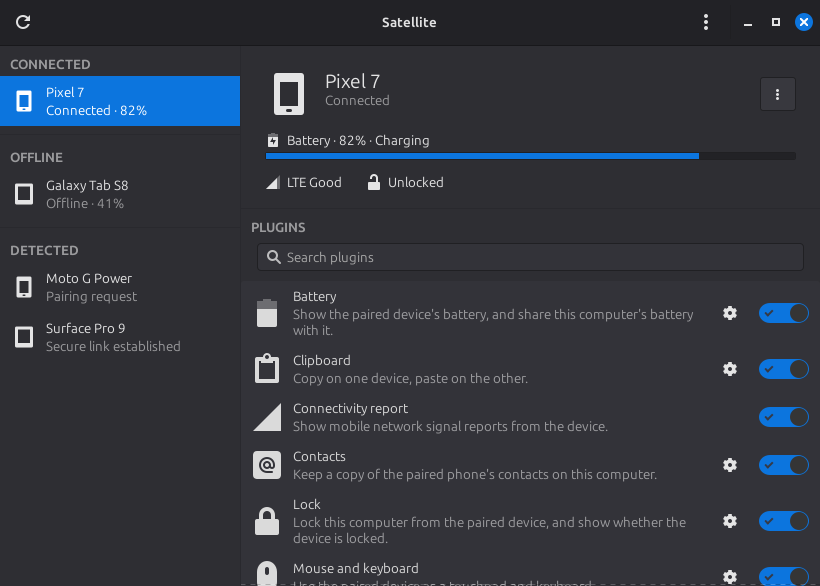
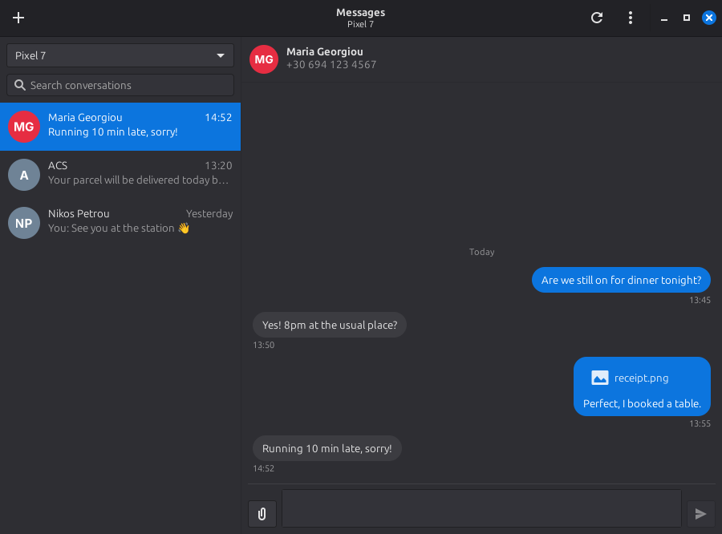
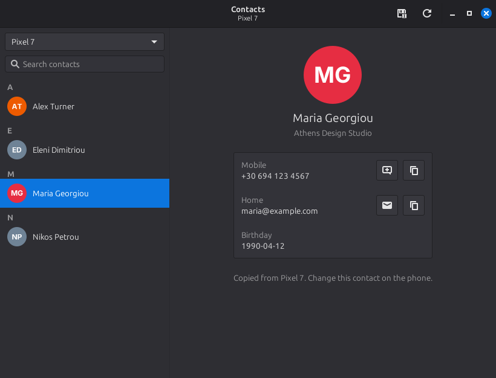

# Satellite

Phone integration for Linux desktops, compatible with KDE Connect.







## Supported devices

- Android phones and tablets with the KDE Connect app.
- Other computers running KDE Connect or Satellite.
- Anything else that speaks the KDE Connect protocol (GSConnect, Valent, etc).

Devices need to be on the same network, or reachable at an address added in
Preferences (other subnets, VPNs, networks that block broadcasts).

What works with a device depends on the plugins both sides support. Each
plugin can be switched off per device, and most have their own settings.

Text messages are read through the phone's SMS/MMS database, which doesn't
hold RCS chats. Satellite Messages can show Google Messages for web instead,
which covers RCS.

## Features

- Pairing, battery, mobile signal and lock state, at a glance on the device page.
- A tray icon with every device and its actions. Satellite starts minimized at
  login and keeps running when the window is closed.
- Send and receive files, text and links. "Send to Phone" in Nemo's
  right-click menu.
- The phone's notifications on the desktop, with their buttons, Reply ("Reply
  in Family" for group chats, which show their recent messages), "Copy" for
  verification codes, and dismissals kept in step both ways. Notifications
  already on the phone when it connects arrive quietly.
- Incoming and missed calls with the caller's photo and a Silence button;
  media is paused or muted while the phone rings.
- This computer's notifications on the phone, with a switch for each app.
- Clipboard sharing, which can skip passwords.
- The phone as a touchpad and keyboard, and as a presenter with a dot,
  picture or spotlight pointer (live preview in its settings).
- This computer's mouse and keyboard on the phone.
- The phone or a tablet as a drawing tablet, with pen pressure and the eraser.
  Without a stylus, hold the pad's "Draw using finger" button.
- One mouse and keyboard shared with another computer: push the pointer over
  the chosen screen edge and it carries on there.
- Media players both ways, with album art: the phone's players on the desktop
  (MPRIS) and this computer's players and volume on the phone.
- Browse the phone's files in the file manager, find the phone, lock this
  computer from the phone, run commands, keep the screensaver away.

## Architecture and connections

`satellite` is the application: the window, the tray icon and the connections
to devices all run in this one process.

`satellite-sms` (Satellite Messages) and `satellite-contacts` (Satellite
Contacts) are companion applications with their own launchers. They talk to
Satellite over D-Bus (`org.x.Satellite.Phone`) and start it in the background
when it isn't running.

- Messages shows the phone's SMS and MMS conversations with contact names and
  pictures, sends replies, group messages and pictures, and loads older
  messages as you scroll. Its menu can switch to Google Messages for web,
  embedded and locked to messages.google.com with its own private storage
  (needs `gir1.2-webkit2-4.1`). Satellite shows what that means before it is
  turned on.
- Contacts shows a read-only copy of the phone's address book, with buttons to
  text, email or copy each entry, and export to a `.vcf` file.

The phone's contacts are also shared with other applications: each phone gets
an address book "<phone> (Satellite)" in Evolution Data Server, which GNOME
Contacts, Evolution and GNOME Calendar read. The phone stays the source: edits
made elsewhere are replaced on the next sync.

Satellite:

- is started minimized at login via XDG autostart (`satellite --background`),
  and by D-Bus activation when a companion application needs it.
- writes to `.xsession-errors`.
- listens on KDE Connect's ports: UDP 1716 and TCP 1716-1764.
- finds devices by broadcast, mDNS (through Avahi) and addresses added by hand.
- loads each plugin from its own folder in `satellite/plugins/<id>/`. A plugin
  handles its packets, its menu actions, its status and its settings dialog.

`satellite-daemon` runs only the connections, without a window or a tray icon.
It is useful for troubleshooting.

`satellite-cli` is a command line tool for scripts and keyboard shortcuts:
`devices`, `ping`, `ring`, `send FILE...`, `text TEXT`, `sms NUMBER TEXT` and
`sync-contacts`.

Satellite stores its data in:

- `~/.config/satellite`: this computer's identity (`device-id`, `device.crt`,
  `device.key`), the certificates of paired devices (`trusted-devices/`),
  plugin choices and settings (`plugins.json`, `device-plugins.json`,
  `plugin-settings.json`), the addresses added by hand (`discovery.json`) and
  preferences and device nicknames (`app.json`).
- `~/.local/share/satellite/contacts/<device id>/`: the phone's contacts, as
  vCard files. Messages are kept in memory only.
- `~/.cache/satellite`: album art, notification icons and caller photos.

Received files go to the download folder chosen in Preferences.

### Troubleshooting connections

If devices don't see each other, check the firewall. Linux Mint's firewall is
off by default; when it is on, allow KDE Connect's ports:

```bash
sudo ufw allow 1714:1764/udp
sudo ufw allow 1714:1764/tcp
```

To see what Satellite is doing, quit it from the tray and run `satellite` in a
terminal. When pairing, both devices show the same verification code. A paired
device's menu → Encryption info shows the TLS version, the cipher and its
certificate fingerprint.

### Input on X11 and Wayland

Satellite moves the pointer and types with `xdotool` on X11. On Wayland it
asks the desktop for permission through the RemoteDesktop portal (once, then
remembers it), or uses `ydotool` when there is no portal. Text `ydotool` can't
type (it only knows the US keyboard) is pasted with `wl-clipboard` instead. The
Mouse and keyboard settings show which one is in use.

The drawing tablet creates a virtual pen tablet through `/dev/uinput`. The udev
rule `60-satellite-uinput.rules` gives the logged-in user access to it. Without
it, the pad draws as the mouse, without pressure.

Sharing the mouse and keyboard with another computer needs an X11 session on
the computer that sends them. Receiving them works on Wayland too.

## Building from source

### For Mint with mint-dev-tools

```bash
# Install mint-dev-tools
sudo apt install mint-dev-tools
# Remove any previous versions
sudo apt remove satellite
# Build and install from github
mint-build -i -g https://github.com/Dimitrysaf/satellite.git
```

### For Debian distributions (Mint, Ubuntu, etc.) with dpkg-buildpackage

```bash
# Get the source code..
git clone https://github.com/Dimitrysaf/satellite.git
# Go in..
cd satellite
# Install the build dependencies..
sudo apt build-dep --mark-auto .
# Remove any previously built packages
rm -f ../satellite*.deb
# Build
dpkg-buildpackage -us -uc
# Install
sudo apt install ../satellite*.deb
```

Satellite can't be installed next to `satellite-gtk`, an unrelated GNSS
application that also installs a `satellite` command. apt offers to remove it.

### For other distributions with meson

```bash
# Get the source code..
git clone https://github.com/Dimitrysaf/satellite.git
# Go in..
cd satellite
```

Install the build and runtime dependencies for your distribution. For example:

```bash
# Fedora: sudo dnf install meson ninja-build python3 gettext
# Arch: sudo pacman -S meson ninja python gettext
# openSUSE: sudo zypper install meson ninja python3 gettext-tools
```

The dependencies are listed below (using debian pkg names, names may be different in your distribution). Install all of them.

#### Dependencies for building

```text
gettext
gtk-update-icon-cache
libglib2.0-bin (for glib-compile-schemas)
meson
python3
```

#### Dependencies for runtime, also needed to run the tests (`meson test`)

```text
gir1.2-glib-2.0
gir1.2-gtk-3.0
gir1.2-xapp-1.0
python3
python3-gi
python3-gi-cairo
python3-openssl
```

#### Other dependencies for runtime

```text
xapps-common
xdotool
```

A D-Bus session bus is also required.

Optional:

```text
avahi-daemon (to find devices with mDNS)
evolution-data-server and gir1.2-ebook-1.2 (to share the phone's contacts with other applications)
pulseaudio-utils (volume control, muting during calls and the Find my device sound)
sshfs (to browse the phone's files)
gir1.2-gtklayershell-0.1 (to keep the presenter pointer above fullscreen slides on Wayland)
gir1.2-webkit2-4.1 (Google Messages for web in Satellite Messages)
ydotool and wl-clipboard (input on Wayland desktops without the RemoteDesktop portal)
```

#### Build and install

```bash
meson setup build --prefix=/usr/local
meson compile -C build
meson test -C build  # optional
sudo meson install -C build
```

With `/usr/local`, the login autostart entry and the udev rule are installed in
folders the system doesn't read. Turn on "Start when you log in" in
Preferences, and
copy the rule for the drawing tablet:

```bash
sudo cp data/60-satellite-uinput.rules /etc/udev/rules.d/
```

#### Uninstall

To remove a Meson installation while retaining the build directory:

```bash
sudo ninja -C build uninstall
```

## Development

```bash
PYTHONPATH=. python3 -m unittest discover -s tests -t .   # tests
python3 tools/preview.py                                  # window on mock devices
xvfb-run -a python3 tools/preview.py --shots /tmp/shots   # headless screenshots
python3 -m satellite_sms                                  # Messages from the checkout
python3 -m satellite_contacts                             # Contacts from the checkout
```

## Translations

Satellite, Satellite Messages and Satellite Contacts are in English, with a
Greek translation. They follow the desktop's language.

The translation template is `satellite.pot` and the translations are in `po/`.
After changing interface text, regenerate the template and update the
translations:

```bash
./makepot
msgmerge --update po/el.po satellite.pot
```

To add a language, create its file from the template, translate it, and add
its code to `po/LINGUAS`:

```bash
msginit --input=satellite.pot --output=po/fr.po --locale=fr
```

The tests check that every language translates every message, and that the
template is up to date.

## License

Code: GPLv3 or later. See [LICENSES/GPL-3.0.txt](LICENSES/GPL-3.0.txt).
